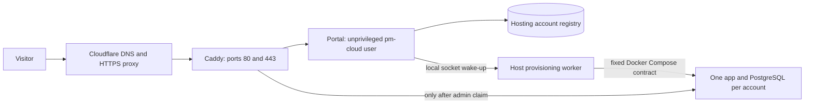

# PaperMarketing Cloud pilot

This directory owns the English website, invitation portal and per-account
hosting service. It runs separately from the PaperMarketing application.
The official domain is `papermarketing.cloud`. Bonorasw is the first customer.
The service is invitation-only. There is no payment integration or paid plan.

## Architecture and authority



- The portal listens on `127.0.0.1:8090`. It cannot read the private RSA key,
  access Docker, or read tenant directories. A hosting session can read only
  its account. Cookies are HttpOnly, Secure and SameSite=Strict. Mutations
  require the exact public Origin, bounded JSON, and persistent rate limits.
- An invitation fixes the email, instance slug and initial workspace name.
  Redemption and account creation share an immediate SQLite transaction.
  Invitations expire after seven days and cannot be reused. The registry
  stores invitation/session hashes, not their bearer values.
- Passwords use scrypt. The provisioning password is separately encrypted
  with the worker's RSA public key, and deleted after bootstrap. Only the
  root worker reads the private key. Portal and application sessions are
  separate; they share the initial credentials, not future password changes.
- A durable account row is the provisioning queue. A local Unix socket wakes
  the worker. Startup recovers queued or interrupted work. There is no idle
  polling. Missing images leave work queued. Failed setup is visible in the
  portal and can be retried by an operator after correcting the cause.
- Each account gets a fixed Compose project, separate network, PostgreSQL,
  application volume and generated database/auth/signing secrets. Tenant
  containers never mount Docker's socket or host administration directories.
- Bootstrap runs in authenticated/private mode on loopback, with no public
  proxy route. The worker creates the user, claims administration and creates
  an empty workspace through application APIs. It then restarts in
  authenticated/public mode, disables application signup, checks anonymous
  denial and publishes the proxy route. No agent or provider account is
  created automatically. Existing task, budget and approval rules are intact.
- Tenant containers opt in to `PAPERCLIP_ALLOW_ISOLATED_PROVIDER_LOGIN=true`.
  This enables the existing browser login flow in a fresh, private directory
  for each user's provider connection. It does not enable trusted local MCP,
  import the operator's CLI credentials, or bypass company/user permissions.
  Public deployments without this explicit setting continue to reject it.

The root worker is a privileged trust boundary. The current portal is for
invited, trusted pilot customers. It is not a hostile-code sandbox. Customers
share the kernel and host; users within one customer instance share its agent
runtime. Do not open anonymous self-service before qualifying stronger worker
isolation, abuse controls, quotas and a recoverable account lifecycle.

## Deployment

Requirements: Linux, Node 24 or later, Docker Engine with Compose, OpenSSL,
and DNS for the apex, `www` and instance subdomains. Use a fixed application
image built from a recorded revision, not an upstream Cloud image.

```sh
docker build --target production \
  --build-arg PAPERCLIP_BUILD_COMMIT=FULL_SOURCE_COMMIT \
  -t papermarketing:REVISION .
# Place this directory at /opt/papermarketing/cloud, owned by root.
CLOUD_IMAGE=papermarketing:REVISION bash /opt/papermarketing/cloud/install.sh
```

`install.sh` installs the portal and worker services, RSA keys, edge Compose
stack, and nightly local-backup timer. It preserves existing keys and tenant
directories. Re-running it rewrites the managed service and edge configuration;
review local customizations first. After source updates, restart the portal and
worker explicitly. Do not restart a worker in the middle of provisioning
unless recovering a failure; its startup path resumes durable pending work.

The pilot host is `179.66.143.84`: two CPUs and approximately 8 GB RAM.
Admission is capped at two accounts. Each tenant app has 2.5 GiB memory,
one CPU and 512 PIDs; its PostgreSQL has 512 MiB, half a CPU and 256 PIDs.
New provisioning requires at least 10 GiB free disk. Docker logs rotate at
three 10 MB files per container. These are initial limits, not a measured
concurrency promise. There is no per-tenant disk quota yet. Check disk and
memory before issuing a second invitation or increasing capacity.

Host state:

| Path | Owner / contents |
| --- | --- |
| `/opt/papermarketing/cloud` | root-owned service source and website |
| `/var/lib/papermarketing-cloud` | pm-cloud registry, WAL and audit records |
| `/etc/papermarketing-cloud` | private/public provisioning keys and service settings |
| `/opt/papermarketing/tenants/SLUG` | root-only Compose config and tenant secrets |
| `/opt/papermarketing/edge` | Caddy config, imported per-tenant routes |
| `/opt/papermarketing/backups` | root-only local backup sets |

## Invitations and operations

Run on the host as root. Treat the generated invitation URL as a secret and
deliver it only to its named recipient. Do not paste it into tickets or logs.

```sh
node /opt/papermarketing/cloud/admin.mjs invite person@example.com team-slug 'Team name'
node /opt/papermarketing/cloud/admin.mjs list
node /opt/papermarketing/cloud/admin.mjs retry team-slug
systemctl status papermarketing-portal papermarketing-worker
docker compose -f /opt/papermarketing/tenants/team-slug/compose.json ps
```

The registry records invitation issuance, account creation, login and tenant
provisioning events. Provider connections and in-application work use the
application's own audit log. Logs must never include passwords, cookies,
invitation codes, Compose environment values or decrypted queue data.

Account recovery and deletion are operator-assisted during this pilot. There
is no public reset-password, billing, cancellation or domain customization
flow. Do not delete volumes to suspend access. Stop that tenant's app and
remove its proxy route from the active edge configuration, preserving the
backups, registry and database. Review and record destructive deletion
separately. Password changes in the workspace do not change the portal password.

## Backups and restore

The local timer runs at 03:30 UTC (00:30 São Paulo), with up to five minutes
of jitter. It briefly stops each app to capture a consistent PostgreSQL dump,
application archive and configuration/secret set. It also captures the hosting
registry and RSA keypair. The app restarts on success or failure. The newest
seven complete sets per tenant are retained. Incomplete backups are never
reported as successful or selected for automatic retention removal.

```sh
bash /opt/papermarketing/cloud/backup.sh bonorasw
systemctl list-timers papermarketing-backup.timer
journalctl -u papermarketing-backup.service
```

Backups contain credentials. They are root-only, but are not encrypted at rest
by these scripts. **Off-host backup is deliberately deferred at the owner's
request. Losing the VPS can currently lose both live data and backups.**
No disaster recovery or uptime SLA is offered.

Restore a set to a new, isolated Compose project, never over a running tenant:

1. Check `SHA256SUMS` and the `COMPLETE` marker.
2. Copy the saved Compose config. Change the project name and loopback port;
   keep both volumes scoped to that new project. Keep it off the public proxy.
3. Start only PostgreSQL; restore with `pg_restore --exit-on-error`.
4. Restore `application.tar.gz` into the new application volume, preserving
   ownership. Use the exact saved application image and generated secrets.
5. Start the app. Verify authenticated health, login, workspaces and files.
6. For a real replacement, stop writes to the previous instance, complete a
   final consistent snapshot, and switch only its Caddy route after checking
   the new target. Retain the previous set until the replacement is confirmed.

A complete host recovery also needs the hosting registry, RSA private key,
service configuration, source revision, proxy routes, and the saved app image
or a reproducible way to rebuild it. Database migration rollback requires the
matching database/files snapshot; an older image alone is insufficient.

## Brand and checks

The site uses the repository's PM monogram, Inter font, charcoal surface and
agent capsule gradients. `sync-brand.mjs` derives colors from
`ui/src/index.css`, so the application remains the owning brand source.

```sh
node cloud/sync-brand.mjs
node --test cloud/core.test.mjs cloud/portal.test.mjs
node --check cloud/worker.mjs
bash -n cloud/install.sh cloud/backup.sh cloud/backup-all.sh
```

The tests exercise HTTP authentication, exact Origin enforcement, request
limits, invitation replay/email mismatch, atomic capacity admission, encrypted
bootstrap secrets, tenant session isolation, expiry and logout. They do not
substitute for a real Docker boot, browser login, backup restore, or external
provider execution. See the deployment record for actual acceptance evidence.

Cloudflare Full (strict) protects the edge-to-origin connection. Caddy manages
the origin certificates using its [automatic HTTPS](https://caddyserver.com/docs/automatic-https)
and [reverse proxy](https://caddyserver.com/docs/caddyfile/directives/reverse_proxy).
Both `papermarketing.cloud` and `bonora.ai` use `art.ns.cloudflare.com` and
`nadia.ns.cloudflare.com`. The latter retains its existing parking records;
no Bonora website or email service is implied by the DNS migration.
